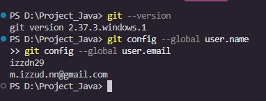
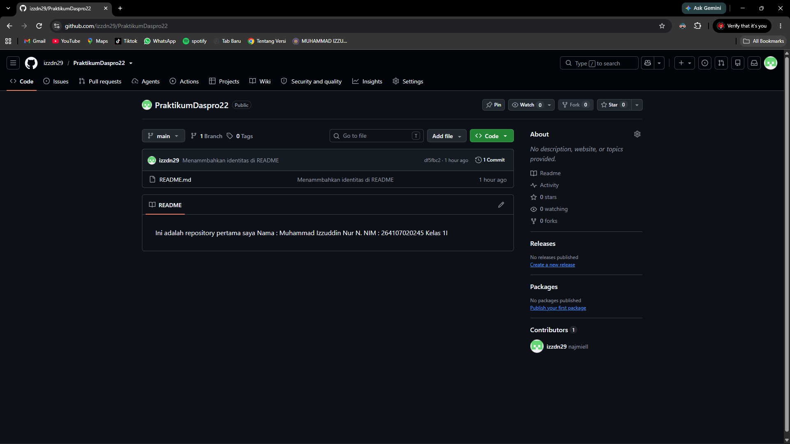
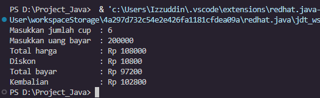
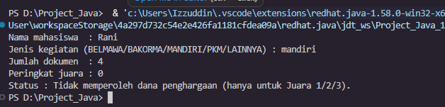

# JOBSHEET 6 - STUDI KASUS PEMILIHAN DENGAN GIT DAN GITHUB

**Identitas Mahasiswa:**
* **Nama:** M. Izzuddin Nur N.
* **NIM:** 264107020245
* **Kelas / No. Presensi:** 1I / 22

---

## 1: TUJUAN PRAKTIKUM

1. Mahasiswa mampu menyelesaikan studi kasus menggunakan struktur pemilihan dasar dan pemilihan bersarang.
2. Mahasiswa mampu menyimpan dan mengumpulkan pekerjaan menggunakan Git dan GitHub melalui Visual Studio Code.
3. Mahasiswa mampu berkolaborasi dengan teman menggunakan GitHub.

---

## 2: HASIL PERCOBAAN & ANALISIS

### 2.1 Persiapan Awal

Persiapan dilakukan sekali pada laptop/PC: membuat akun GitHub, menginstal Git (pengaturan default), membuka ulang VS Code, lalu mengatur identitas Git melalui **Terminal → New Terminal**.

```
git config --global user.name "<username-github>"
git config --global user.email "<email-github>"
```



---

### 2.2 Percobaan 1: Menyiapkan Repository

Langkah pengerjaan:

1. Membuat repository **Public** bernama `PraktikumDaspro22` di GitHub (Add README: Off).
2. Menyalin URL HTTPS repository, lalu *clone* melalui VS Code (**Clone Git Repository... → Clone from URL**).
3. Membuat `README.md` berisi identitas, lalu *Stage Changes* (Add).
4. *Commit* dengan pesan `Menambahkan identitas di README`, kemudian *Push* (**Publish Branch**).
5. Memastikan `README.md` muncul di halaman repository GitHub.

#### 2.2.1 Isi README.md
```
Ini adalah repository pertama saya
Nama  : M. Izzuddin Nur N.
NIM   : 264107020245
Kelas : 1I
```

#### 2.2.2 Hasil Running / Screenshot



---

### 2.3 Percobaan 2: Studi Kasus 1 – Pemilihan Dasar

Program kasir Kedai Kopi Senja: harga Rp 18.000 per cup, diskon 10% jika total harga minimal Rp 100.000, lalu menghitung total bayar dan kembalian (atau kekurangan uang).

#### 2.3.1 Kode Program Java
```java
// StudiKasus122.java
import java.util.Scanner;

public class StudiKasus122 {
    public static void main(String[] args) {
        Scanner sc = new Scanner(System.in);

        // Deklarasi variabel (sesuai flowchart)
        int hargaPerCup = 18000;
        int jumlahCup, uangBayar;
        int totalHarga, diskon, totalBayar;
        int kembalian, kurang;

        // Input
        System.out.print("Masukkan jumlah cup  : ");
        jumlahCup = sc.nextInt();
        System.out.print("Masukkan uang bayar  : ");
        uangBayar = sc.nextInt();

        // Hitung total harga dan diskon
        totalHarga = jumlahCup * hargaPerCup;
        diskon = 0;
        if (totalHarga >= 100000) {
            diskon = totalHarga * 10 / 100;
        }
        totalBayar = totalHarga - diskon;

        // Output rincian harga
        System.out.println("Total harga          : Rp " + totalHarga);
        System.out.println("Diskon               : Rp " + diskon);
        System.out.println("Total bayar          : Rp " + totalBayar);

        // Cek uang bayar
        if (uangBayar >= totalBayar) {
            kembalian = uangBayar - totalBayar;
            System.out.println("Kembalian            : Rp " + kembalian);
        } else {
            kurang = totalBayar - uangBayar;
            System.out.println("Uang tidak cukup, kurang Rp " + kurang);
        }

        sc.close();
    }
}
```

#### 2.3.2 Hasil Running / Screenshot Output



Uji 1 – tanpa diskon, uang kurang:
```
Masukkan jumlah cup  : 3
Masukkan uang bayar  : 50000
Total harga          : Rp 54000
Diskon               : Rp 0
Total bayar          : Rp 54000
Uang tidak cukup, kurang Rp 4000
```

Uji 2 – diskon 10%, ada kembalian:
```
Masukkan jumlah cup  : 6
Masukkan uang bayar  : 200000
Total harga          : Rp 108000
Diskon               : Rp 10800
Total bayar          : Rp 97200
Kembalian            : Rp 102800
```

Uji 3 – batas bawah diskon (5 cup = Rp 90.000, belum diskon), uang pas lebih:
```
Masukkan jumlah cup  : 5
Masukkan uang bayar  : 100000
Total harga          : Rp 90000
Diskon               : Rp 0
Total bayar          : Rp 90000
Kembalian            : Rp 10000
```

Uji 4 – diskon 10%, uang kurang:
```
Masukkan jumlah cup  : 10
Masukkan uang bayar  : 150000
Total harga          : Rp 180000
Diskon               : Rp 18000
Total bayar          : Rp 162000
Uang tidak cukup, kurang Rp 12000
```

#### 2.3.3 Analisis
* `if (totalHarga >= 100000)` menentukan diskon; jika tidak terpenuhi, `diskon` tetap 0.
* `if (uangBayar >= totalBayar)` memilih antara menampilkan kembalian atau kekurangan uang, sesuai flowchart.

#### 2.3.4 Riwayat Commit
| No | Pesan Commit | Isi |
| :---: | :--- | :--- |
| 1 | `SK1: input dan deklarasi variabel` | Deklarasi variabel dan input |
| 2 | `SK1: logika diskon dan kembalian` | Logika diskon, total bayar, kembalian |

Setelah kode selesai dilakukan **Push**.

---

### 2.4 Percobaan 3: Studi Kasus 2 – Pemilihan Bersarang

Program cek status dana penghargaan mahasiswa. Hanya data yang diperlukan yang ditanyakan sesuai jenis kegiatan. Kedalaman *nested if* maksimal 3 tingkat.

#### 2.4.1 Kode Program Java
```java
// StudiKasus222.java
import java.util.Scanner;

public class StudiKasus222 {
    public static void main(String[] args) {
        Scanner sc = new Scanner(System.in);

        String nama, jenis;
        int dokumen, peringkat, statusPkm;

        System.out.print("Nama mahasiswa  : ");
        nama = sc.nextLine();
        System.out.print("Jenis kegiatan (BELMAWA/BAKORMA/MANDIRI/PKM/LAINNYA) : ");
        jenis = sc.nextLine().trim();

        // Cabang 1: perlombaan (BELMAWA, BAKORMA, atau Mandiri)
        if (jenis.equalsIgnoreCase("BELMAWA") || jenis.equalsIgnoreCase("BAKORMA")
                || jenis.equalsIgnoreCase("Mandiri")) {
            System.out.print("Jumlah dokumen  : ");
            dokumen = sc.nextInt();
            System.out.print("Peringkat juara : ");
            peringkat = sc.nextInt();

            if (peringkat >= 1 && peringkat <= 3) {            // tingkat 2: juara 1, 2, atau 3
                if (dokumen == 4) {                             // tingkat 3: dokumen lengkap
                    System.out.println("Status : Berhak memperoleh dana penghargaan (Juara " + peringkat + ").");
                } else {
                    System.out.println("Status : Dokumen tidak lengkap (kurang " + (4 - dokumen)
                            + " dokumen). Dana penghargaan tidak diberikan.");
                }
            } else {
                System.out.println("Status : Tidak memperoleh dana penghargaan (hanya untuk Juara 1/2/3).");
            }

        // Cabang 2: Program Kreativitas Mahasiswa (PKM)
        } else if (jenis.equalsIgnoreCase("PKM")) {
            System.out.print("Jumlah dokumen  : ");
            dokumen = sc.nextInt();
            System.out.print("Status pendanaan PKM (1 = lolos, 0 = tidak lolos) : ");
            statusPkm = sc.nextInt();

            if (statusPkm == 1) {                               // tingkat 2: lolos pendanaan
                if (dokumen == 4) {                             // tingkat 3: dokumen lengkap
                    System.out.println("Status : Berhak memperoleh dana penghargaan (PKM lolos pendanaan).");
                } else {
                    System.out.println("Status : Dokumen tidak lengkap (kurang " + (4 - dokumen)
                            + " dokumen). Dana penghargaan tidak diberikan.");
                }
            } else {
                System.out.println("Status : Tidak memperoleh dana penghargaan (PKM tidak lolos pendanaan).");
            }

        // Cabang 3: Lainnya
        } else if (jenis.equalsIgnoreCase("Lainnya")) {
            System.out.println("Status : Tidak memperoleh dana penghargaan (jenis kegiatan tidak termasuk ketentuan).");

        // Jenis kegiatan di luar pilihan
        } else {
            System.out.println("Status : Jenis kegiatan tidak valid.");
        }

        sc.close();
    }
}
```

#### 2.4.2 Hasil Running / Screenshot Output



Uji 1 – BAKORMA, dokumen kurang:
```
Nama mahasiswa  : Dori
Jenis kegiatan (BELMAWA/BAKORMA/MANDIRI/PKM/LAINNYA) : bakorma
Jumlah dokumen  : 3
Peringkat juara : 1
Status : Dokumen tidak lengkap (kurang 1 dokumen). Dana penghargaan tidak diberikan.
```

Uji 2 – Mandiri, bukan juara:
```
Nama mahasiswa  : Rani
Jenis kegiatan (BELMAWA/BAKORMA/MANDIRI/PKM/LAINNYA) : Mandiri
Jumlah dokumen  : 4
Peringkat juara : 0
Status : Tidak memperoleh dana penghargaan (hanya untuk Juara 1/2/3).
```

Uji 3 – PKM lolos, dokumen lengkap:
```
Nama mahasiswa  : Budi
Jenis kegiatan (BELMAWA/BAKORMA/MANDIRI/PKM/LAINNYA) : pkm
Jumlah dokumen  : 4
Status pendanaan PKM (1 = lolos, 0 = tidak lolos) : 1
Status : Berhak memperoleh dana penghargaan (PKM lolos pendanaan).
```

Uji 4 – Lainnya:
```
Nama mahasiswa  : Sinta
Jenis kegiatan (BELMAWA/BAKORMA/MANDIRI/PKM/LAINNYA) : Lainnya
Status : Tidak memperoleh dana penghargaan (jenis kegiatan tidak termasuk ketentuan).
```

Uji 5 – BELMAWA, Juara 2, dokumen lengkap:
```
Nama mahasiswa  : Andi
Jenis kegiatan (BELMAWA/BAKORMA/MANDIRI/PKM/LAINNYA) : BELMAWA
Jumlah dokumen  : 4
Peringkat juara : 2
Status : Berhak memperoleh dana penghargaan (Juara 2).
```

Uji 6 – PKM lolos, dokumen kurang:
```
Nama mahasiswa  : Tia
Jenis kegiatan (BELMAWA/BAKORMA/MANDIRI/PKM/LAINNYA) : PKM
Jumlah dokumen  : 3
Status pendanaan PKM (1 = lolos, 0 = tidak lolos) : 1
Status : Dokumen tidak lengkap (kurang 1 dokumen). Dana penghargaan tidak diberikan.
```

Uji 7 – PKM tidak lolos:
```
Nama mahasiswa  : Eko
Jenis kegiatan (BELMAWA/BAKORMA/MANDIRI/PKM/LAINNYA) : pkm
Jumlah dokumen  : 4
Status pendanaan PKM (1 = lolos, 0 = tidak lolos) : 0
Status : Tidak memperoleh dana penghargaan (PKM tidak lolos pendanaan).
```

Uji 8 – jenis kegiatan di luar pilihan:
```
Nama mahasiswa  : Lia
Jenis kegiatan (BELMAWA/BAKORMA/MANDIRI/PKM/LAINNYA) : kompetisi
Status : Jenis kegiatan tidak valid.
```

#### 2.4.3 Analisis
* Tingkat 1: memilih jenis kegiatan (lomba / PKM / Lainnya).
* Tingkat 2: memeriksa syarat prestasi (Juara 1–3 atau PKM lolos).
* Tingkat 3: memeriksa kelengkapan 4 dokumen; jika kurang, ditampilkan `4 - dokumen`.
* `equalsIgnoreCase()` membuat jenis kegiatan tidak peka huruf besar/kecil.

#### 2.4.4 Riwayat Commit
| No | Pesan Commit | Isi |
| :---: | :--- | :--- |
| 1 | `SK2: cabang lomba` | Cabang BELMAWA, BAKORMA, Mandiri |
| 2 | `SK2: cabang PKM dan lainnya` | Cabang PKM, Lainnya, dan jenis tidak valid |

Setelah kode selesai dilakukan **Push**.

---

### 2.5 Percobaan 4: Uji Silang Program Teman

Pengerjaan berpasangan dan bergantian.

**Sebagai pemilik repository:** *Settings → Collaborators → Add people*, memasukkan username GitHub teman, lalu *Add to repository*.

**Sebagai mahasiswa yang diundang:** menerima undangan (*Accept invitation*), meng-*clone* repository teman, menjalankan `StudiKasus2<NoPresensi>.java` dengan minimal 3 data uji, menuliskan hasilnya di bagian bawah `README.md`, lalu *Add* dan *Commit & Push* dengan pesan `Hasil uji SK2 oleh <Nama>`.

**Pemilik repository:** melakukan *Pull*, memastikan hasil uji teman muncul di `README.md`, dan memeriksa riwayat **Commits**.

#### 2.5.1 Data Uji pada Program Sendiri

| No | Jenis | Dokumen | Peringkat / Pendanaan | Output | Sesuai? |
| :---: | :--- | :---: | :---: | :--- | :---: |
| 1 | BAKORMA | 3 | Juara 1 | Dokumen tidak lengkap (kurang 1 dokumen). Dana penghargaan tidak diberikan. | Ya |
| 2 | Mandiri | 4 | 0 | Tidak memperoleh dana penghargaan (hanya untuk Juara 1/2/3). | Ya |
| 3 | pkm | 4 | 1 (lolos) | Berhak memperoleh dana penghargaan (PKM lolos pendanaan). | Ya |
| 4 | Lainnya | 4 | (tidak ditanyakan) | Tidak memperoleh dana penghargaan (jenis kegiatan tidak termasuk ketentuan). | Ya |

#### 2.5.2 Hasil Uji Teman pada README.md

```
Hasil Uji Studi Kasus 2 oleh <Nama Teman>
| No | Jenis | Dokumen | Juara/Dana | Output | Sesuai? |
|----|-------|---------|------------|--------|---------|
| 1  |       |         |            |        |         |
| 2  |       |         |            |        |         |
| 3  |       |         |            |        |         |
```


---

### 2.6 Bukti Commit dan Push ke GitHub

Repository: `PraktikumDaspro22`


---

## 3: KESIMPULAN

Pemilihan `if-else` dipakai untuk keputusan dua arah (diskon, kembalian), sedangkan *nested if* dipakai untuk syarat berlapis (jenis kegiatan, prestasi, kelengkapan dokumen). Git dan GitHub di VS Code memungkinkan pekerjaan disimpan bertahap lewat *add*, *commit*, dan *push*, serta dikolaborasikan dengan teman lewat *collaborator*, *pull*, dan *sync*.
